# Checkpoint Git & GitHub : learn_git

Ce dépôt contient une capture d'écran du terminal pour **chaque étape** des instructions (dossier [`captures/`](captures)). Toutes les commandes sont aussi regroupées dans [`commandes.sh`](commandes.sh).

| # | Étape | Commande |
|---|---|---|
| 1 | Créer un dossier appelé learn_git | `mkdir learn_git` |
| 2 | Se placer dans le dossier learn_git | `cd learn_git && pwd` |
| 3 | Créer un fichier third.txt | `touch third.txt && ls` |
| 4 | Initialiser un dépôt git vide | `git init` |
| 5 | Ajouter third.txt à la staging area | `git add third.txt && git status` |
| 6 | Commiter avec le message "adding third.txt" | `git commit -m "adding third.txt"` |
| 7 | Vérifier le commit avec git log | `git log` |
| 8 | Créer un fichier fourth.txt | `touch fourth.txt && ls` |
| 9 | Ajouter fourth.txt à la staging area | `git add fourth.txt && git status` |
| 10 | Commiter avec le message "adding fourth.txt" | `git commit -m "adding fourth.txt"` |
| 11 | Supprimer le fichier third.txt | `rm third.txt && ls` |
| 12 | Ajouter la modification à la staging area (git add .) | `git add . && git status` |
| 13 | Commiter avec le message "removing third.txt" | `git commit -m "removing third.txt"` |
| 14 | Vérifier les commits avec git log | `git log` |
| 15 | Régler le paramètre global core.pager sur cat | `git config --global core.pager cat && git config --global core.pager` |
| 16 | Lister toutes les configurations globales | `git config --global --list` |

> Remarque : dans l'historique de ce dépôt, deux anciens commits portent le message « adding tiers.txt » / « removing tiers.txt ». Les captures ci-dessous montrent l'exercice refait avec les messages exacts demandés : **adding third.txt**, **adding fourth.txt**, **removing third.txt**.

## Captures

### Étape 1 : Créer un dossier appelé learn_git
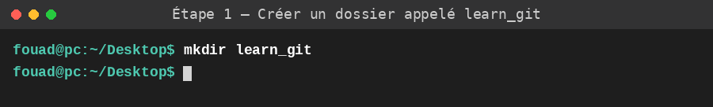

### Étape 2 : Se placer dans le dossier learn_git
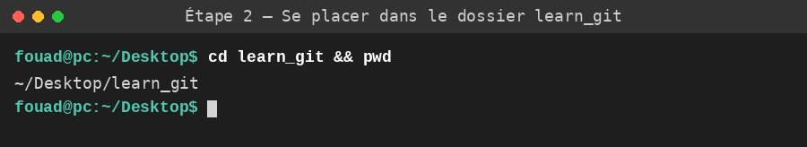

### Étape 3 : Créer un fichier third.txt
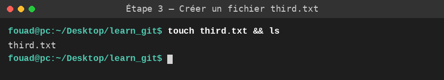

### Étape 4 : Initialiser un dépôt git vide
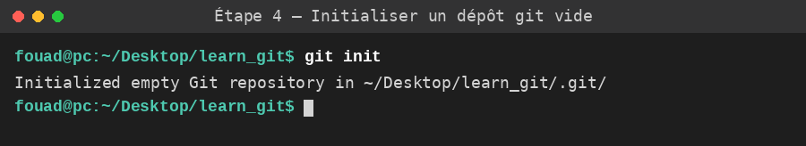

### Étape 5 : Ajouter third.txt à la staging area
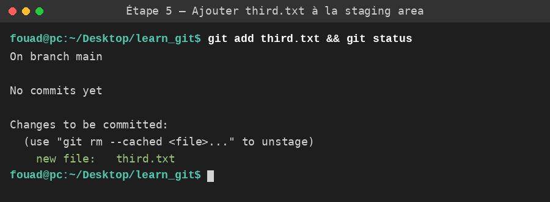

### Étape 6 : Commiter avec le message "adding third.txt"
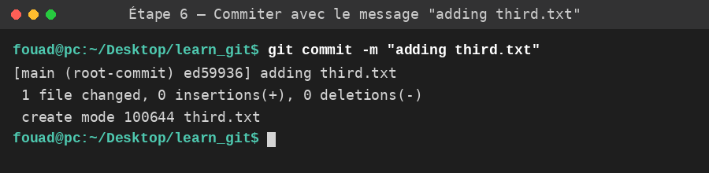

### Étape 7 : Vérifier le commit avec git log
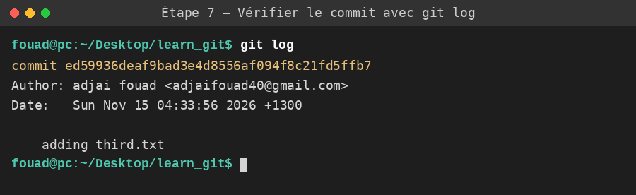

### Étape 8 : Créer un fichier fourth.txt
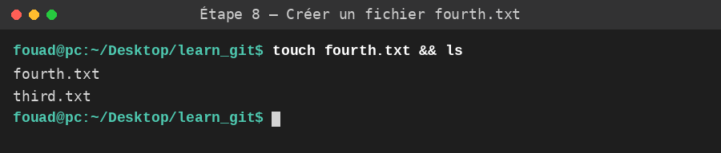

### Étape 9 : Ajouter fourth.txt à la staging area
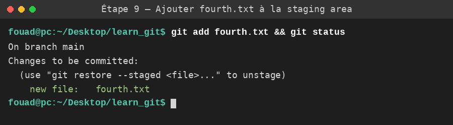

### Étape 10 : Commiter avec le message "adding fourth.txt"
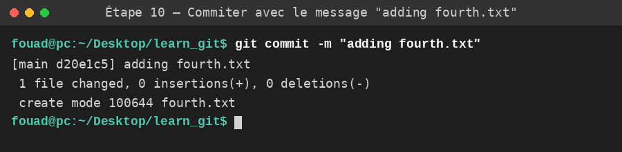

### Étape 11 : Supprimer le fichier third.txt
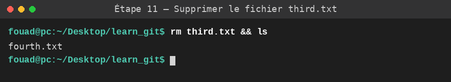

### Étape 12 : Ajouter la modification à la staging area (git add .)
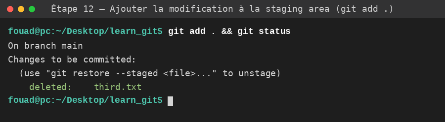

### Étape 13 : Commiter avec le message "removing third.txt"
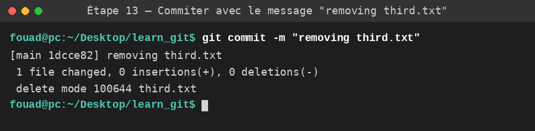

### Étape 14 : Vérifier les commits avec git log
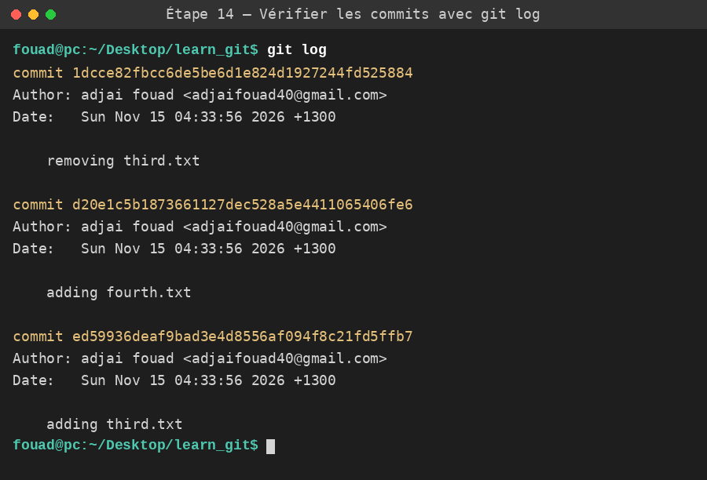

### Étape 15 : Régler le paramètre global core.pager sur cat
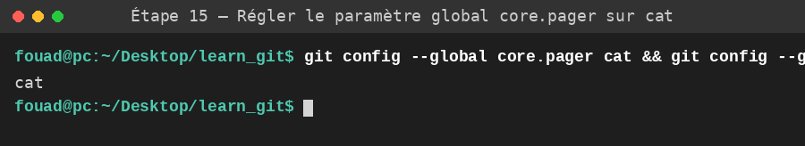

### Étape 16 : Lister toutes les configurations globales
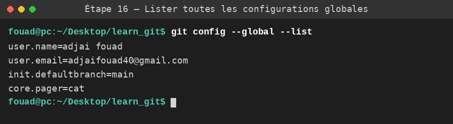

